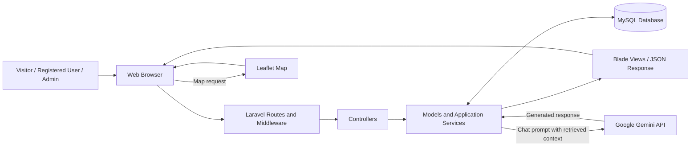
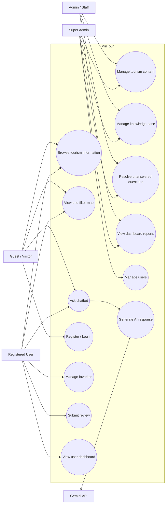
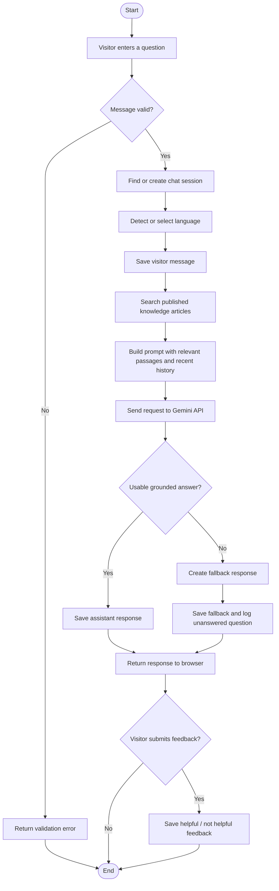
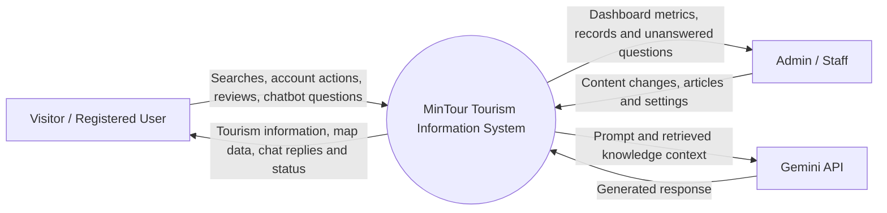
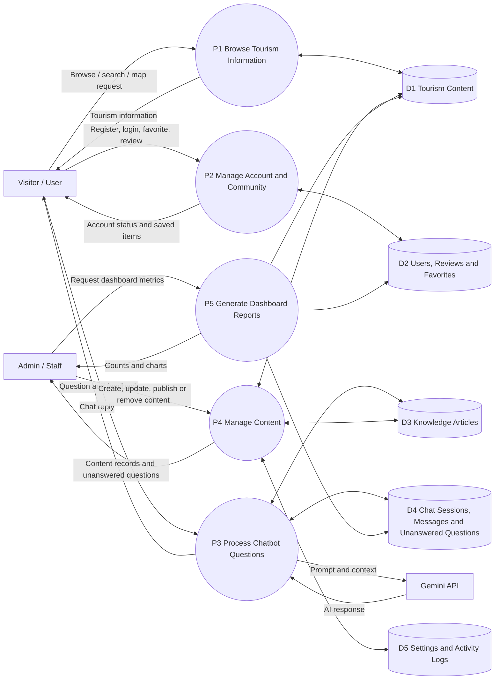
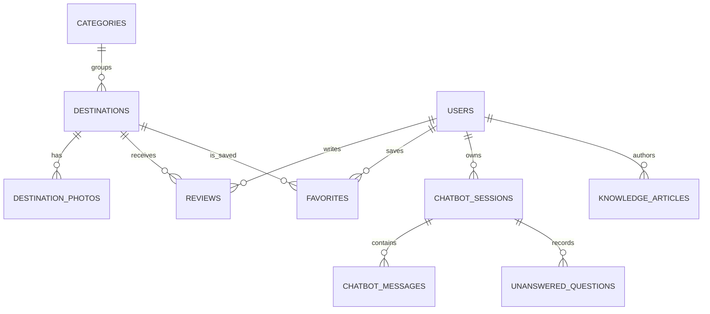

# Chapter 3: Methodology

## 3.1 System Description

Ang **MinTour** ay isang web-based tourism information system para sa Victoria, Oriental Mindoro. Layunin nitong pagsamahin sa iisang website ang mga impormasyong kailangan ng mga bisita, kabilang ang mga destinasyon, mapa, matutuluyan, kainan, lokal na produkto, events, gallery, at frequently asked questions (FAQs). Mayroon din itong user accounts, favorites, destination reviews, admin panel, at bilingual AI chatbot na gumagamit ng knowledge base ng system.

May dalawang pangunahing bahagi ang system:

1. **Public website** - para sa mga bisitang naghahanap ng impormasyon tungkol sa Victoria.
2. **Admin panel** - para sa mga awtorisadong staff na namamahala sa tourism content, chatbot knowledge base, user records, system settings, at dashboard reports.

Ang MinTour ay information and promotion platform. Sa kasalukuyang implementation nito, hindi kasama ang online booking, reservation, checkout, o payment processing.

### 3.1.1 User Roles

| User role | Pangunahing kakayahan |
|---|---|
| Guest / Visitor | Mag-browse ng public tourism content, gumamit ng mapa, at magtanong sa chatbot. |
| Registered User | Gumamit ng public features, mag-save ng destinations bilang favorites, mag-post ng review, at tingnan ang sariling dashboard. |
| Staff | Gumamit ng mga admin feature na pinapayagan ng role at mamahala ng tourism information. |
| Admin | Mag-access ng admin panel at mamahala ng system content. |
| Super Admin | Gumamit ng admin features, kabilang ang user management na limitado sa super admin. |
| Gemini API | Panlabas na AI service na bumubuo ng chatbot response mula sa tanong at knowledge passages na ipinadala ng MinTour. |

Ang role access ay hinahawakan ng role middleware at policy checks. Ang mga admin route ay nangangailangan ng authenticated admin-level account. Ang user-management operations ay may mas mahigpit na super-admin authorization.

### 3.1.2 System Flow

1. Binubuksan ng bisita ang MinTour gamit ang web browser.
2. Pumipili ang bisita ng tourism section: destinations, map, accommodations, restaurants, products, events, gallery, o FAQs.
3. Sa destination list, maaaring maghanap, mag-filter ayon sa category, at mag-sort ng resulta. Sa interactive map, maaaring tingnan ang destination markers at mag-filter ayon sa category.
4. Maaaring magbukas ang bisita ng destination detail page para makita ang paglalarawan, lokasyon, larawan at iba pang available na detalye.
5. Ang naka-login na user ay maaaring mag-save ng destination bilang favorite at magsumite ng review.
6. Kapag nagtanong sa chatbot, ipinapadala ang mensahe sa chat API. Tinutukoy ng system ang wika, hinahanap ang kaugnay na published knowledge articles, at ipinapasa sa Gemini ang tanong, relevant passages at limitadong chat history.
7. Ipinapakita ang chatbot response at sine-save ang user at assistant messages. Kapag walang sapat na grounded na sagot o nag-fail ang AI call, ibinabalik ang fallback response at maaaring maitala ang tanong sa unanswered questions.
8. Nagla-log in ang admin sa protected admin area. Mula roon ay namamahala siya ng content at knowledge articles, tumitingin ng dashboard, at nagsusuri ng unanswered questions.
9. Kapag nag-update ng content ang admin, sine-save ito sa database. Ang published content ang ipinapakita sa public website; ang knowledge article ay kailangang published upang maisama sa retrieval.

Ang public routes ay nasa [`routes/web.php`](../routes/web.php), ang chatbot at map API routes ay nasa [`routes/api.php`](../routes/api.php), at ang admin routes ay nasa [`routes/admin.php`](../routes/admin.php).

## 3.2 Development Method

Angkop na ilarawan ang development ng MinTour bilang **iterative at incremental** kung ito ang aktuwal na prosesong sinunod ng project team. Sa paraang ito, binubuo ang system sa magkakahiwalay na bahagi, sinusubukan ang bawat bahagi, at inaayos ang mga natukoy na problema bago idagdag o pagbutihin ang susunod na bahagi.

Maaaring ilahad ang mga increment bilang:

1. Pagsusuri ng tourism information at requirements.
2. Pagbuo ng database structure at pangunahing public pages.
3. Pagdaragdag ng authentication at user features.
4. Pagbuo ng admin content-management modules.
5. Pagdaragdag ng knowledge base at chatbot integration.
6. Pagsubok, pag-aayos, at paghahanda para sa deployment.

**Para sa final manuscript:** kumpirmahin sa project team na tugma ang methodology na ito sa aktuwal na ginawa. Palitan o baguhin ang paliwanag kung ibang development method ang ginamit.

## 3.3 Gantt Chart

Gamitin ang talahanayan bilang gabay sa pagbuo ng Gantt chart. Ilagay ang aktuwal na linggo, buwan o petsa ng proyekto; walang schedule dates na nakukuha mula sa source code.

| Phase / Activity | Inaasahang output | Schedule |
|---|---|---|
| Requirements gathering and analysis | Requirements at scope ng system | Ilagay ang aktuwal na petsa |
| System and database design | Architecture, diagrams at schema | Ilagay ang aktuwal na petsa |
| Public tourism pages and map | Browse, search, filters at map | Ilagay ang aktuwal na petsa |
| Authentication and user features | Login, registration, favorites at reviews | Ilagay ang aktuwal na petsa |
| Admin panel | Content-management modules at dashboard | Ilagay ang aktuwal na petsa |
| Knowledge base and chatbot | Article retrieval at Gemini integration | Ilagay ang aktuwal na petsa |
| Testing and revisions | Test results at bug fixes | Ilagay ang aktuwal na petsa |
| Deployment and documentation | Deployed system at final documentation | Ilagay ang aktuwal na petsa |

## 3.4 Requirements Specifications

### 3.4.1 Functional Requirements

Ang system ay dapat:

1. Magpakita ng published tourism destinations at destination details.
2. Magbigay ng paghahanap, category filtering, at sorting para sa destinations.
3. Magpakita ng interactive map na may destination markers at category filters.
4. Magpakita ng accommodations, restaurants, local products, events, gallery, FAQs, announcements at emergency contacts kung may kaugnay na published o active content.
5. Magbigay ng user registration, login at logout.
6. Magbigay sa authenticated user ng kakayahang mag-save ng favorites, magsumite ng destination review, at tingnan ang sariling dashboard.
7. Tumanggap ng chatbot messages at magpanatili ng session history para sa guest o authenticated user.
8. Maghanap ng relevant published knowledge articles at gamitin ang mga ito bilang context sa chatbot.
9. Magbigay ng fallback response at magtala ng tanong kapag walang sapat na sagot mula sa chatbot.
10. Magbigay sa admin ng dashboard metrics at content-management tools.
11. Magbigay ng admin tools para sa pagsusuri at pagresolba ng unanswered questions.
12. Magbigay ng settings para sa site name, contact email, default language at piling chatbot options.
13. Limitahan ang user-management operations sa super admin.

### 3.4.2 User Interface Requirements

- Gumagana sa modernong desktop at mobile web browsers.
- May public navigation para sa pangunahing tourism sections.
- May responsive admin navigation at dashboard cards/charts.
- May forms para sa paghahanap, login, registration, content entry at editing.
- Nagpapakita ng validation errors, success messages at empty states.
- Nagpapakita ng destination images, location information at map controls kung available ang data.

Ang interface ay binuo gamit ang Laravel Blade views, Tailwind CSS at Alpine.js. Ang admin dashboard ay nasa [`resources/views/admin/dashboard.blade.php`](../resources/views/admin/dashboard.blade.php), at ang shared admin layout ay nasa [`resources/views/layouts/admin.blade.php`](../resources/views/layouts/admin.blade.php).

### 3.4.3 Hardware Interface Requirements

Walang espesyal na hardware interface na kailangan.

- **Client:** computer, tablet o smartphone na may supported web browser at internet access.
- **Server:** host o computer na kayang magpatakbo ng PHP/Laravel application at database service.

Ang eksaktong CPU, memory at storage requirements ay dapat itakda ayon sa aktuwal na deployment environment at inaasahang dami ng users. Walang partikular na server hardware configuration na naka-define sa source code.

### 3.4.4 Software Interface Requirements

Batay sa project configuration at setup documentation, kabilang sa software requirements ang:

- PHP 8.2 o mas bago.
- Laravel 12.
- Composer para sa PHP dependencies.
- MySQL 8+ bilang inirerekomendang production database; ginagamit ng knowledge base ang MySQL FULLTEXT search kapag available.
- Node.js at npm para sa frontend asset tooling.
- Vite, Tailwind CSS at Alpine.js para sa frontend.
- Leaflet para sa interactive map.
- Google Gemini API at server-side API key para sa AI chatbot. Kapag walang configured Gemini key o nagkaroon ng API failure, maaaring magbalik ang chatbot ng fallback response.

Mga setup detail ay nasa [`README.md`](../README.md), at ang chatbot configuration ay nasa [`config/gemini.php`](../config/gemini.php).

### 3.4.5 Security Requirements

- Nangangailangan ng authentication ang protected account at admin operations.
- Sinusuri ng role middleware ang access sa admin area.
- Super admin lamang ang pinapayagang magsagawa ng user-management operations.
- Vina-validate ng application ang user input bago ito iproseso o i-save.
- Gumagamit ang Laravel forms ng CSRF protection.
- Hinahash ang password bago i-save.
- May rate limiting ang login, registration, map API at chatbot endpoints.
- Nasa server environment configuration ang Gemini API key; hindi ito dapat ilagay sa public client code.
- Dapat gumamit ng HTTPS, malakas na admin password at secure environment configuration sa production.

## 3.5 Technical Background

### 3.5.1 Hardware Specifications

Walang project-specific minimum o recommended hardware configuration na nakasaad sa source code. Para sa manuscript, ilahad ang aktuwal na specifications ng development at deployment machine. Kung hindi pa napipili ang production host, markahan ang server specifications bilang proposed requirements sa halip na verified facts.

### 3.5.2 Software Specifications

| Layer | Technology |
|---|---|
| Server-side application | PHP 8.2+ and Laravel 12 |
| Database | MySQL 8+ recommended for production |
| Templates / UI | Laravel Blade |
| CSS and UI behavior | Tailwind CSS and Alpine.js |
| Asset bundling | Vite and Node.js/npm |
| Interactive map | Leaflet |
| AI chatbot | Google Gemini API |
| PHP dependency management | Composer |

## 3.6 System Analysis and Design

### 3.6.1 System Overview

Ang MinTour ay gumagamit ng MVC (Model-View-Controller) application structure:

- **Models** kumakatawan sa database records at relationships.
- **Views** nagpapakita ng public at admin interfaces gamit ang Blade.
- **Controllers** tumatanggap ng web/API requests, nagsasagawa ng validation at kumukuha o nagbabago ng data.
- **Services** naghahawak ng chatbot orchestration, language detection at knowledge retrieval.
- **Database** nag-iimbak ng user accounts, tourism content, chatbot data, settings at iba pang records.
- **Gemini API** external service na ginagamit sa pagbuo ng chatbot response.

### 3.6.2 System Architecture

Ang diagram ay logical view ng application; maaaring mag-iba ang aktuwal na deployment topology depende sa hosting setup.

## 3.7 Use Case Diagram

## 3.8 Activity Diagram: Chatbot

## 3.9 Data Flow Diagrams

### 3.9.1 Context Diagram

### 3.9.2 Diagram 0 / Level 0 DFD

## 3.10 Database Schema

Ang database migrations ay nagtatakda ng mga sumusunod na pangunahing tables:

| Table | Layunin at pangunahing relasyon |
|---|---|
| `users` | User profile, email, hashed password, role, preferred language at active status. |
| `categories` | Categories na ginagamit sa pag-uuri ng destinations. |
| `destinations` | Destination descriptions, category, coordinates, location details, rating at publish status. May foreign key sa `categories`. |
| `destination_photos` | Gallery photos na nakaugnay sa destination. |
| `accommodations` | Matutuluyan, presyo kada gabi, lokasyon, amenities at publish status. |
| `restaurants` | Kainan, cuisine, price range, lokasyon at publish status. |
| `products` | Local products, maker, price, description at publish status. |
| `events` | Event title, schedule, location, description at publish status. |
| `announcements` | System/public announcements at priority. |
| `faqs` | Tanong, sagot, category at publish status. |
| `emergency_contacts` | Emergency agency/contact records. |
| `reviews` | User reviews na naka-link sa user at destination. |
| `favorites` | User-to-destination saved items; may unique constraint para hindi madoble ang favorite. |
| `knowledge_articles` | Chatbot knowledge content, category, source, tags, publish state at author references. |
| `chatbot_sessions` | Chat session na pag-aari ng registered user o guest token. |
| `chatbot_messages` | User at assistant messages na naka-link sa chatbot session. |
| `unanswered_questions` | Mga tanong na kailangang masagot o maidagdag sa knowledge base. |
| `settings` | Configurable system settings. |
| `activity_logs` | Admin/system activity metadata. |

Simplified relationship view:

Ang diagram ay pinasimple para sa documentation. Para sa eksaktong columns, foreign keys at indexes, sumangguni sa mga migration sa [`database/migrations`](../database/migrations).

## 3.11 Testing and Evaluation

May automated Laravel tests para sa admin workflows, chatbot behavior at Gemini service. Sa huling naitalang full test run habang inihahanda ang dokumentong ito, **19 tests ang pumasa na may 101 assertions**.

Saklaw ng automated tests ang:

- Pagbukas ng admin dashboard at content modules.
- Destination admin actions at gallery photo deletion.
- Generic CRUD forms at slug-based record resolution.
- Pag-save at pag-validate ng system settings.
- Pag-restrict ng user-management sa super admin.
- Chat session creation, message flow, feedback at fallback behavior.
- Knowledge retrieval at Gemini API response handling.

Ang automated test result ay hindi kapalit ng user acceptance testing. Kung hinihingi ng pag-aaral ang system evaluation mula sa respondents, magsagawa at mag-ulat ng hiwalay na evaluation gamit ang questionnaire o itinakdang evaluation instrument.

## 3.12 Implementation Plan

Maaaring ilahad ang implementation sequence sa ganitong paraan:

1. Ihanda ang PHP/Laravel environment, database at environment variables.
2. I-install ang PHP at frontend dependencies.
3. I-configure ang database at patakbuhin ang migrations at seeders.
4. I-configure ang storage para sa uploaded images at frontend assets.
5. Ilagay ang Gemini API key sa server environment kung gagamitin ang AI chatbot.
6. Subukan ang public browsing, map, authentication, account features, admin access at chatbot.
7. I-deploy sa target host at tiyakin ang HTTPS, credentials, backups at production configuration.
8. Regular na i-review at i-update ang tourism content, larawan, rates, contact details at chatbot knowledge base.

Ang local setup commands ay nasa [`README.md`](../README.md). Bago mag-publish ng tourism listings, dapat beripikahin ang operating status, presyo, opening hours, contact details at access information sa venue o opisyal na source.

## 3.13 Documentation Notes

- Palitan ang mga placeholder sa Gantt chart ng aktuwal na project schedule.
- Kumpirmahin na tama ang development methodology ayon sa aktuwal na proseso ng grupo.
- Ilagay ang totoong hardware specifications ng development at production environment.
- Kung magdaragdag ng screenshots, lagyan ang bawat isa ng figure number, caption at maikling paliwanag ng user flow na ipinapakita nito.
- I-check ang format, numbering at citation style ayon sa template ng paaralan.
